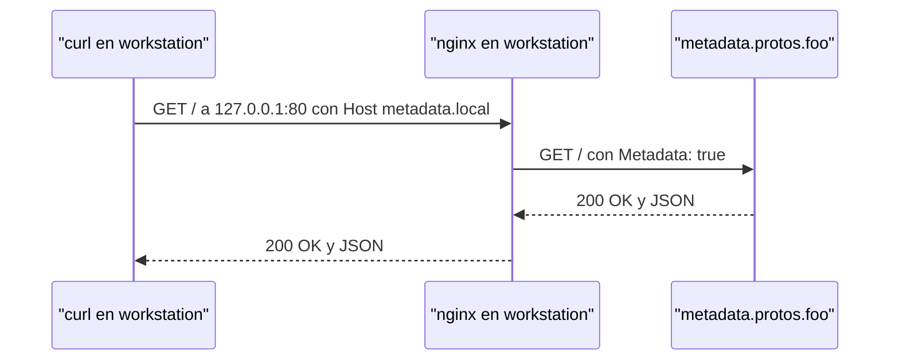

# LabProtos2026 · Ejercicio 2 · Proxy inverso con nginx

## Qué pide el ejercicio

Montar un proxy local que devuelva el JSON de `http://metadata.protos.foo` al ejecutar exactamente `curl http://metadata.local`. El servidor de destino exige el encabezado `Metadata: true`. La restricción sobre las opciones de `curl` aplica a la prueba final contra `metadata.local`.

El ejercicio se hizo dentro de la workstation del laboratorio, con el prompt `root@workstation:/#`. nginx ya estaba instalado.

## 1. Averiguar qué espera el servidor de destino

Primero consultamos el destino directamente. `-i` muestra la línea de estado y los encabezados HTTP junto con el cuerpo. Nos permite ver si el pedido tuvo éxito y qué tipo de contenido llegó.

```bash
curl -i http://metadata.protos.foo
```

Salida real

```http
HTTP/1.1 403 Forbidden
Server: nginx/1.27.5
Date: Mon, 09 Nov 2026 20:21:29 GMT
Content-Type: text/html
Content-Length: 153
Connection: keep-alive

<html>
<head><title>403 Forbidden</title></head>
<body>
<center><h1>403 Forbidden</h1></center>
<hr><center>nginx/1.27.5</center>
</body>
</html>
```

El `403` indica que llegamos al servidor y este rechazó el pedido. Probamos de nuevo cambiando una sola cosa. Con `-H` agregamos al pedido el encabezado indicado en el enunciado.

```bash
curl -i -H "Metadata: true" http://metadata.protos.foo
```

Salida real

```http
HTTP/1.1 200 OK
Server: nginx/1.27.5
Date: Mon, 09 Nov 2026 20:21:52 GMT
Content-Type: application/json
Content-Length: 80
Connection: keep-alive

{"hola": "mundo", "vmName": "who_cares", "credentials": "superdupersecrettoken"}
```

Cambió de `403` con HTML a `200` con JSON. Por eso el proxy tiene que reproducir el segundo pedido. El usuario va a ejecutar un `curl` común y nginx va a agregar `Metadata: true` en el tramo hacia el destino.

## 2. Hacer que metadata.local llegue al nginx de la workstation

```bash
nano /etc/hosts
```

Agregamos una entrada para el nombre local.

```text
127.0.0.1 metadata.local
```

### Comprobar la resolución antes de configurar nginx

Después de guardar `/etc/hosts`, corré este comando dentro de la workstation.

```bash
getent hosts metadata.local
```

Salida esperada en este laboratorio

```text
127.0.0.1 metadata.local
```

`getent hosts` consulta la resolución de nombres del sistema, que tiene en cuenta `/etc/hosts`. Si devuelve `127.0.0.1`, el nombre ya apunta a la workstation donde vas a levantar el proxy. Si no devuelve nada o muestra otra IP, revisá la entrada en `/etc/hosts` antes de pasar al paso 3. Esta comprobación se puede hacer con nginx apagado porque solo verifica la resolución del nombre.

Al ejecutar `curl http://metadata.local`, la workstation necesita convertir `metadata.local` en una IP para abrir una conexión TCP. `/etc/hosts` registra esa asociación en la máquina donde corre `curl`. Elegimos `127.0.0.1` porque **el cliente y el nginx que actúa de proxy están en la misma workstation**. HTTP usa el puerto 80 en esta URL.

Una vez conectada a `127.0.0.1:80`, la solicitud sigue llevando `Host: metadata.local`. nginx usa ese nombre para elegir el bloque `server_name metadata.local`. La resolución del nombre y la selección del bloque son pasos separados.



| Dato | Qué decide |
|---|---|
| `127.0.0.1 metadata.local` en `/etc/hosts` | A qué IP se conecta el cliente que usa la URL local. |
| `server_name metadata.local` | Qué bloque elige nginx cuando llega el pedido HTTP. |
| `proxy_pass http://metadata.protos.foo` | A qué servidor se conecta nginx para buscar el contenido. |

Si pusieras la IP del backend en la entrada de `metadata.local`, `curl` iría directamente al backend y se saltearía el nginx que agrega el encabezado. Si el cliente corriera **en otra máquina**, su `127.0.0.1` apuntaría a sí mismo. En ese caso el cliente necesita que `metadata.local` resuelva a una dirección alcanzable del proxy y que el puerto del proxy sea accesible. La entrada puede venir de `/etc/hosts` en el cliente o de un DNS que use el cliente. [Cómo selecciona nginx el bloque que atiende una solicitud](https://nginx.org/en/docs/http/request_processing.html)

## 3. Configurar el proxy

```bash
nano /etc/nginx/conf.d/metadata.conf
```

```nginx
server {
    listen 80;
    server_name metadata.local;

    location / {
        proxy_pass http://metadata.protos.foo;
        proxy_set_header Metadata true;
    }
}
```

| Directiva | Qué hace en esta configuración |
|---|---|
| `listen 80;` | Atiende solicitudes HTTP en el puerto 80. |
| `server_name metadata.local;` | Identifica el bloque para el nombre que usa el cliente en la URL. |
| `location /` | Aplica el proxy a la raíz y a los demás caminos que coincidan con este prefijo. |
| `proxy_pass http://metadata.protos.foo;` | Reenvía la solicitud al backend HTTP. Como acá la URL de `proxy_pass` lleva solo esquema y host, el pedido a `/` llega como `/`. |
| `proxy_set_header Metadata true;` | Establece el valor `true` en el encabezado `Metadata` del pedido que sale hacia el backend. |

En la configuración del ejercicio, nginx genera el `Host` hacia el backend a partir de `proxy_pass`. Así, el cliente usa `Host: metadata.local` para entrar a nuestro proxy y el backend recibe `Host: metadata.protos.foo`. El encabezado adicional que exige el backend es `Metadata: true`. [Directivas del módulo proxy de nginx](https://nginx.org/en/docs/http/ngx_http_proxy_module.html)

## 4. Validar, arrancar y demostrar

```bash
nginx -t && nginx
```

`nginx -t` comprueba la configuración. El operador `&&` ejecuta el segundo comando solo si el primero termina correctamente. En este caso el segundo comando inicia nginx en la workstation.

Salida real

```text
nginx: the configuration file /etc/nginx/nginx.conf syntax is ok
nginx: configuration file /etc/nginx/nginx.conf test is successful
```

Prueba final, tal como la pide el enunciado

```bash
curl http://metadata.local
```

Salida real

```json
{"hola": "mundo", "vmName": "who_cares", "credentials": "superdupersecrettoken"}
```

Es el mismo JSON que devolvió el destino cuando le mandamos `Metadata: true` explícitamente. En la terminal, el prompt apareció pegado al final porque el cuerpo venía sin un salto de línea final.

## 5. Qué puede variar en el parcial

Estos ejemplos son variantes independientes. Se aplican cuando el enunciado o una prueba del backend pide ese comportamiento.

### Cambia la URL que tiene que escribir el cliente

Si te piden `curl http://panel.local:8080`, cambiás el nombre y el puerto de entrada de forma coordinada.

| Dato | Ejemplo |
|---|---|
| Nombre que resuelve el cliente | `127.0.0.1 panel.local` en `/etc/hosts`, si el cliente y el proxy están en la misma máquina. |
| Nombre que identifica el bloque nginx | `server_name panel.local;` |
| Puerto de entrada al proxy | `listen 8080;` |

El puerto del backend se configura por separado. Si el destino fuera `http://backend.lab:9000`, iría en `proxy_pass http://backend.lab:9000;`. El puerto que escribe el cliente es el de `listen`. [Selección de servidor en nginx](https://nginx.org/en/docs/http/request_processing.html) · [Sintaxis de proxy_pass](https://nginx.org/en/docs/http/ngx_http_proxy_module.html#proxy_pass)

### El backend pide encabezados específicos

Si la consigna pide que el **backend reciba** un encabezado, usá `proxy_set_header` dentro del `location` que hace el proxy. Se puede poner una línea por encabezado.

```nginx
location / {
    proxy_pass http://backend.lab;
    proxy_set_header Metadata true;
    proxy_set_header X-Legajo 63051;
    proxy_set_header Accept-Language es;
}
```

Para deducir qué poner, primero probá el backend con `curl -i` y después repetí con `-H 'Nombre: valor'`. Si ese cambio produce la respuesta buscada, traducilo a `proxy_set_header Nombre valor;`.

Si la consigna pide que **el cliente vea** un encabezado en la respuesta del proxy, la directiva correspondiente es `add_header`. Por ejemplo, `add_header X-Lab nginx always;` agrega `X-Lab: nginx` a la respuesta, incluso para códigos de error. [proxy_set_header](https://nginx.org/en/docs/http/ngx_http_proxy_module.html#proxy_set_header) · [add_header](https://nginx.org/en/docs/http/ngx_http_headers_module.html#add_header)

### El backend exige un Host especial

La pista típica es «conectate a tal IP o puerto con `Host: secrethost`» o una prueba directa que solo funciona al agregar ese encabezado. Supongamos que en esa variante el destino es `192.0.2.20:8080`. Primero lo probás con `curl`.

```bash
curl -i -H 'Host: secrethost' http://192.0.2.20:8080/
```

Si la variante usa ese destino y requiere ese nombre, este bloque reproduce el pedido.

```nginx
location / {
    proxy_pass http://192.0.2.20:8080;
    proxy_set_header Host secrethost;
}
```

`proxy_pass` decide a qué IP y puerto se conecta nginx. `proxy_set_header Host secrethost;` decide qué nombre HTTP ve el backend. Si además pide `Metadata: true`, agregá esa directiva en el mismo bloque.

Si el enunciado dice que el backend debe recibir **exactamente el Host que mandó el cliente**, la variante es `proxy_set_header Host $http_host;`. Si te piden el nombre recibido con un valor de respaldo cuando el encabezado falta, podés usar `$host`. [Host en solicitudes proxificadas](https://nginx.org/en/docs/http/ngx_http_proxy_module.html#proxy_set_header)

### Cambia el camino de entrada o el camino en el backend

Para un `location` por prefijo, mirá qué camino tiene que recibir el backend al pedir, por ejemplo, `http://metadata.local/api/status`.

| Qué pide la consigna | Configuración dentro de `location /api/` | Camino que recibe el backend |
|---|---|---|
| Conservar la ruta del cliente | `proxy_pass http://backend.lab;` | `/api/status` |
| Quitar el prefijo `/api/` | `proxy_pass http://backend.lab/;` | `/status` |
| Cambiar `/api/` por `/v1/` | `proxy_pass http://backend.lab/v1/;` | `/v1/status` |

La barra después del host en el segundo ejemplo ya es una ruta. En estos bloques, cuando `proxy_pass` incluye una ruta, esa ruta reemplaza el prefijo que coincidió con `location`. Si la consigna dice «solo el pedido a la raíz debe ir a `/metadata`», podés usar un bloque exacto.

```nginx
location = / {
    proxy_pass http://backend.lab/metadata;
}
```

[Reglas de URI en proxy_pass](https://nginx.org/en/docs/http/ngx_http_proxy_module.html#proxy_pass)

### Cambiás la configuración con nginx ya levantado

```bash
nginx -t && nginx -s reload
```

Después de editar, primero validás y luego recargás la configuración del proceso que ya está en ejecución. Repetí la prueba final con la URL exacta del enunciado. [Control del proceso nginx](https://nginx.org/en/docs/control.html)
